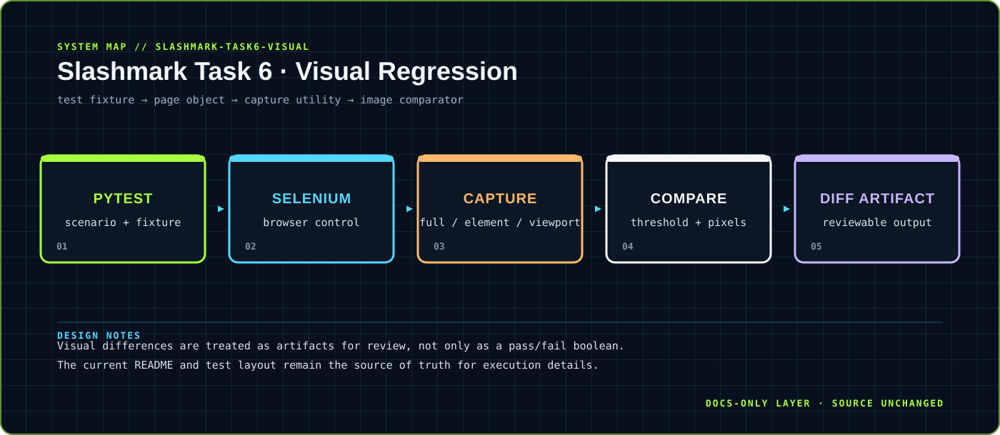

<div align="center">



</div>

# Slashmark Task 6 · Visual Regression

> Screenshot capture, pixel comparison and diff artifacts for browser interfaces.

A Python + Selenium + pytest + Pillow test suite for baseline capture, current capture and visual difference reporting.

<div align="center">

`Python · Selenium · pytest · Pillow` &nbsp;·&nbsp; `browser page → screenshot → comparison → diff artifact`

</div>

## `01 / SYSTEM CARD`

- **Primary boundary:** `test fixture → page object → capture utility → image comparator`
- **Documentation stance:** architecture and presentation only; application source is intentionally untouched.
- **Visual language:** Y2K terminal grid, brutalist labels, maximalist contrast, readable static SVG fallback.

## `02 / ARCHITECTURE`

The map above is a compact view of the repository's visible runtime boundary. It is designed to answer three questions quickly: where input enters, where policy or domain logic lives, and where external side effects leave the system.


## `03 / DESIGN NOTES`

- Visual differences are treated as artifacts for review, not only as a pass/fail boolean.
- The current README and test layout remain the source of truth for execution details.

This upgrade adds documentation assets only. It does not change source files, dependency manifests, tests, workflows or runtime configuration.

## `04 / EXISTING PROJECT DOCUMENTATION`

<details open>
<summary>Read the original project notes</summary>

# Task 6 — Visual Automation Testing

Visual regression testing suite using Python + Selenium + pytest + Pillow. Captures baseline screenshots, compares against new captures, and generates pixel-level diff images.

## What's Tested

- **Screenshot Capture** — Full page, element-level, viewport screenshots
- **Visual Regression** — Baseline vs current comparison, pixel diff, threshold pass/fail
- **Diff Image Generation** — Highlighted visual differences between screenshots
- **Layout Validation** — Element positioning, visibility, responsive breakpoints
- **Cross-page Visual Checks** — Consistent UI across multiple pages

## Setup

```bash
python3 -m venv venv
source venv/bin/activate
pip install -r requirements.txt

# Create directories for visual testing
mkdir -p baselines diffs
```

## Run Tests

```bash
# All tests
pytest

# By category
pytest -m visual
pytest -m screenshot
pytest -m regression

# Generate HTML report
pytest --html=reports/report.html --self-contained-html

# Update baselines (after intentional UI changes)
pytest --update-baselines
```

## Project Structure

```
├── conftest.py
├── tests/
├── pages/
├── utils/
│   └── visual_comparator.py    # Screenshot comparison logic
├── baselines/                  # Baseline screenshots (git-tracked)
├── diffs/                      # Generated diff images
└── screenshots/                # Current captures
```

## Tech Stack

- Python 3 + Selenium 4 + pytest
- Pillow (PIL) for image comparison
- Page Object Model design pattern
- WebDriver Manager for automatic browser driver management

## Intern

**M Vignesh Sai** — Slash Mark Internship (June 2026)

</details>

